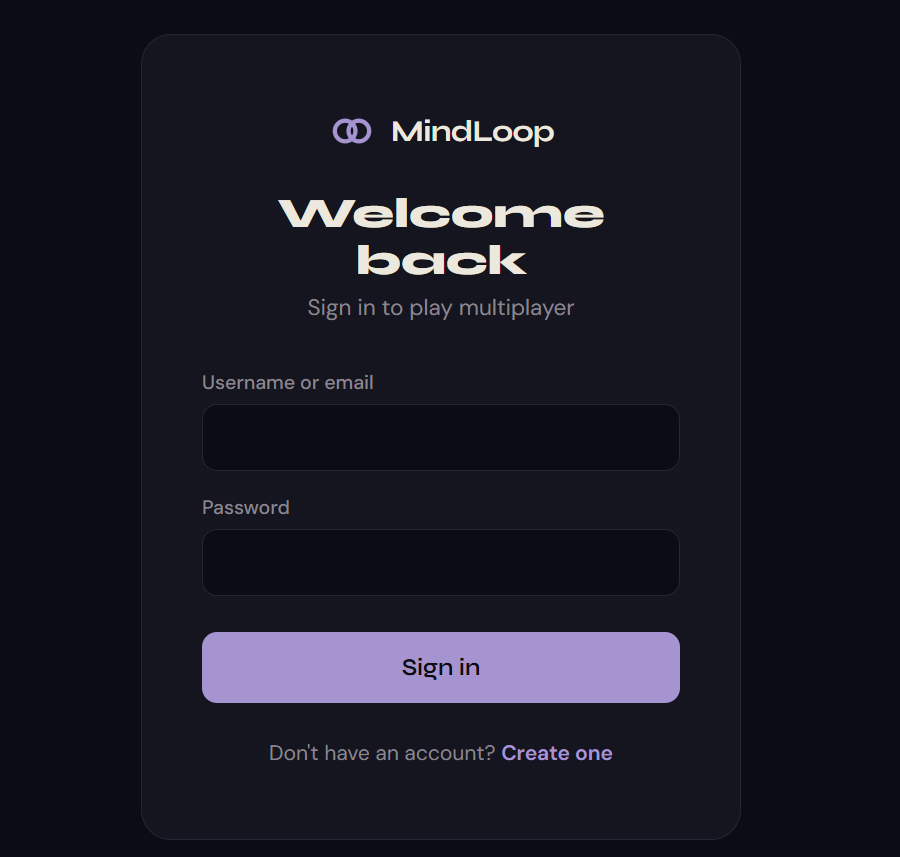
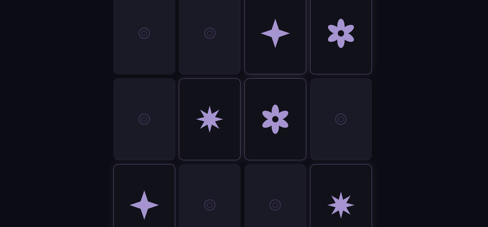

# MindLoop - Memory Card Game

A multiplayer memory card game with real-time 1v1 matches, Elo rating, and a solo practice mode.

## Screenshots

<p align="center">
  
  &nbsp;&nbsp;
  
</p>

## Features

- **Solo Mode** - Practice memory matching at 4 difficulty levels (no account required)
- **Multiplayer 1v1** - Real-time matches via private rooms or Elo-based matchmaking
- **Server-Authoritative** - All game logic runs server-side; card identities are never sent to clients until revealed
- **Elo Rating** - K=32 system with matchmaking that pairs players of similar skill
- **Reconnection** - 60-second window to rejoin a match after disconnecting
- **Leaderboard, Match History, Player Profiles**

## Tech Stack

| Layer    | Tech |
|----------|------|
| Client   | React 19, TypeScript, Vite, React Router, Socket.IO Client, Lucide icons |
| Server   | Node.js, Express 5, Socket.IO, JWT + bcrypt, Zod validation |
| Database | PostgreSQL 18 |
| Shared   | TypeScript workspace package with shared types |

## Prerequisites

- Node.js 20+
- PostgreSQL 14+ (any recent version)
- npm 9+

## Setup

```bash
# 1. Install dependencies (from project root)
npm install

# 2. Create the database
psql -U postgres -c "CREATE DATABASE mindloop;"

# 3. Configure the server
cp server/.env.example server/.env
# Edit server/.env — set DATABASE_URL and generate a random JWT_SECRET:
#   node -e "console.log(require('crypto').randomBytes(48).toString('hex'))"

# 4. Run migrations
npm run db:migrate

# 5. Start development servers (client + server)
npm run dev
```

The client runs on http://localhost:5173 and proxies API/WebSocket requests to the server on port 3001.

## Project Structure

```
mindloop-memory-game/
  shared/          # Shared TypeScript types (Difficulty, Socket events, etc.)
  server/          # Express + Socket.IO backend
    src/
      routes/      # REST API (auth, profile, leaderboard, matches)
      game/        # GameEngine, Room, MatchmakingQueue
      socket/      # Socket.IO event handlers
      middleware/   # JWT auth middleware
    migrations/    # PostgreSQL migrations
    tests/         # Vitest test suite
  client/          # React frontend (Vite)
    src/
      pages/       # Route pages (Solo, Multiplayer, Lobby, Profile, etc.)
      components/  # Shared components (Landing, Card, etc.)
      context/     # AuthContext (JWT session management)
      hooks/       # useSocket hook
      api/         # API client with auto-refresh
```

## Scripts

| Command | Description |
|---------|-------------|
| `npm run dev` | Start client + server in dev mode |
| `npm run build` | Build all packages |
| `npm test` | Run server test suite (72 tests) |
| `npm run db:migrate` | Apply database migrations |

## API Routes

All API routes are prefixed with `/api`.

| Method | Path | Auth | Description |
|--------|------|------|-------------|
| POST | /auth/register | No | Create account |
| POST | /auth/login | No | Login (username or email) |
| POST | /auth/refresh | Cookie | Rotate refresh token |
| POST | /auth/logout | Yes | Logout |
| GET | /auth/me | Yes | Current player profile |
| GET | /leaderboard | No | Paginated leaderboard |
| GET | /profile/:id | Yes | View player profile |
| PATCH | /profile/me | Yes | Update display name / avatar |
| GET | /matches | Yes | Paginated match history |
| GET | /matches/:id | Yes | Match detail |

## Socket.IO Events

### Client -> Server
- `room:create` - Create a private room
- `room:join` - Join by room code
- `matchmaking:join` - Enter Elo matchmaking queue
- `matchmaking:leave` - Leave queue
- `game:flip` - Flip a card

### Server -> Client
- `game:start` - Game begins (difficulty, opponent, turn info)
- `game:card-revealed` - A card was flipped (index + symbol)
- `game:match-found` - Two cards matched (scores update)
- `game:mismatch` - Two cards didn't match (turn switches)
- `game:over` - Game finished (winner, Elo changes)
- `game:state-restored` - Full board state on reconnection
- `game:opponent-disconnected` / `game:opponent-reconnected`
- `game:forfeited` - Opponent timed out

## Testing

```bash
# Run all server tests
cd server && npx vitest run

# Run specific test file
npx vitest run tests/engine.test.ts
```

Test coverage:
- **GameEngine** (21 tests) - deck creation, card flipping, match/mismatch, scoring, completion
- **MatchmakingQueue** (10 tests) - add/remove, Elo matching, range expansion, cross-difficulty rejection
- **Room** (12 tests) - player management, start/stop, disconnect/reconnect, forfeit timeout
- **API Integration** (29 tests) - auth flows, token rotation, profile CRUD, leaderboard, matches

## Security

- Passwords hashed with bcrypt (12 rounds)
- JWT access tokens (15m) + rotating refresh tokens (7d, SHA-256 hashed, HttpOnly cookie)
- Rate limiting on auth endpoints (3 register/min, 5 login/min)
- All SQL queries are parameterized
- Input validation via Zod on all endpoints
- Helmet security headers
- Server-authoritative game state (clients never see unrevealed cards)
